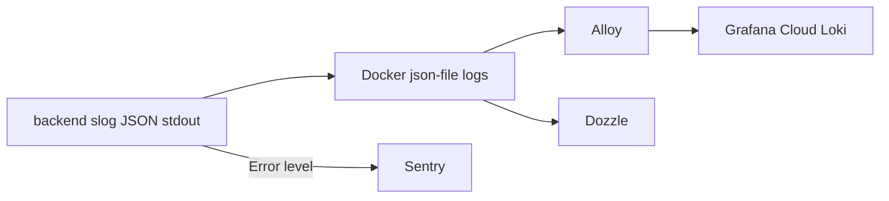

# Logging architecture

Backend logs and errors flow through three tools. Read this before adding a feature that logs, handles errors, or changes the Docker setup.

| Tool                           | Purpose                                             | Where                |
| ------------------------------ | --------------------------------------------------- | -------------------- |
| `slog` to stdout               | The only way the backend emits logs                 | `internal/logging`   |
| Sentry                         | Errors and panics, grouped into issues, with alerts | sentry.io            |
| Grafana Cloud (Loki) via Alloy | Searchable log history and dashboards               | grafana.com          |
| Dozzle                         | Live container log viewer for quick debugging       | SSH tunnel to the VM |



## How the backend logs

- `logging.Setup(cfg)` in `main.go` installs the default logger. `ENV=production` writes JSON at Info level; anything else writes text at Debug level.
- If `SENTRY_DSN` is set, every `slog.Error` is also sent to Sentry. Without it nothing is sent, so local development needs no setup.
- `logging.Middleware` wraps the whole HTTP handler. It logs one `HTTP request` line (method, path, status, duration_ms), skips `/health`, and converts panics into a logged 500.

## Rules for new code

1. Use `slog` with key/value pairs. Never `fmt.Println`, `log.Printf` or `println`.
2. Put the error under the key `error`: `slog.Error("Failed to create video", "error", err, "owner_id", ownerID)`. The Sentry handler reads that key to build the issue, and groups issues by message.
3. Keep messages constant and put variable data in attributes. Do not interpolate ids into the message, or Sentry creates one issue per id.
4. Levels:
   - `Error`: something broke and a person should look (reported to Sentry). Use it for unexpected failures only.
   - `Warn`: handled or expected problems (bad input, retries, a missing optional config). Not sent to Sentry.
   - `Info`: lifecycle events and business milestones (startup, shutdown, video ready).
   - `Debug`: development detail. Dropped in production.
5. Log an error once, at the layer that handles it (usually the handler's `writeServiceError` or a worker loop). Services wrap and return errors; they do not also log them.
6. Never log secrets or personal data: passwords, session ids, CSRF tokens, cookies, `Authorization` headers, presigned URLs, DSNs, email addresses. Ids (`uuid`) are fine.
7. Do not log request or response bodies.
8. Background work (processor, janitor) logs `Error` for a failed job with the job id attribute so the Sentry issue is traceable.
9. New configuration (DSNs, tokens) is read in `config.Load()` only. Numbers such as timeouts live in `config/limits.go`.
10. Frontend errors are out of scope here. If the frontend gets Sentry later, use a separate Sentry project and DSN.

## Setup on the VM

1. **Sentry**: create a Go project, copy the DSN, set `SENTRY_DSN` in `.env`. Add an alert rule for new issues.
2. **Grafana Cloud**: in the stack, open Connections, then Loki, and note the push URL, the user id and create an access token with the `logs:write` scope. Set in `.env`:
   ```
   GRAFANA_LOKI_URL=https://logs-prod-XXX.grafana.net/loki/api/v1/push
   GRAFANA_LOKI_USER=<numeric user id>
   GRAFANA_LOKI_TOKEN=<access token>
   ```
3. Start everything (set `ENV=production` in `.env`):
   ```
   docker compose --profile observability up -d --build
   ```
   Without `--profile observability` only the backend and Postgres run.
4. **Dozzle** listens on `127.0.0.1:8888` on the VM only. Open it from your laptop with a tunnel:
   ```
   ssh -L 8888:127.0.0.1:8888 <user>@151.145.93.160
   ```
   then browse to http://localhost:8888. Do not open port 8888 in the Oracle security list.

## Querying in Grafana

- All backend errors: `{service="backend", level="ERROR"}`
- One request path: `{service="backend"} | json | path="/api/videos"`
- Slow requests: `{service="backend"} | json | duration_ms > 1000`

## Security notes

- Alloy and Dozzle mount `/var/run/docker.sock` read-only. That still exposes container metadata, which is why Dozzle stays on localhost.
- Keep tokens in `.env` (gitignored). Never commit them.
- Log rotation is set in `docker-compose.yml` (10 MB x 3 files per container).
